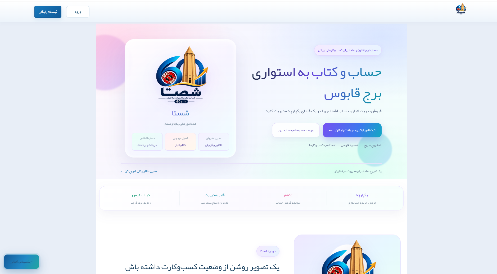
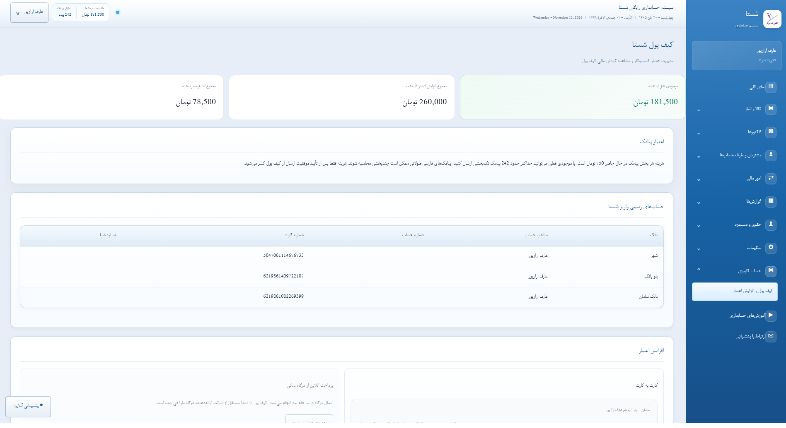
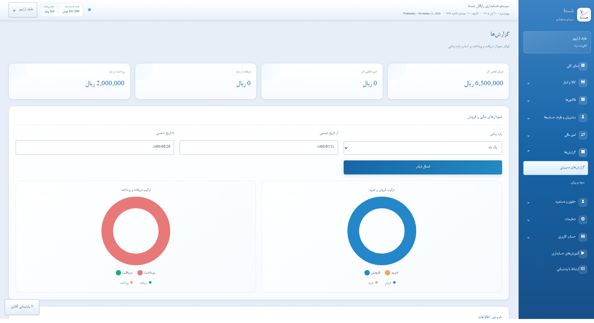

SHASTA | Online Accounting & Business Management System

  

# 👋 Hi, I'm Aref Arazpour

**Software Developer | Web Application Developer**

I design and develop web-based applications focused on solving real-world business problems.

## 🚀 Featured Project

### SHASTA – Online Accounting System

A comprehensive online accounting and business management platform designed to simplify financial operations.

  

🌐 **Website:** https://60a.ir

**Main Features:**
- Complete Accounting Management
- Sales & Purchase Invoices
- Inventory & Warehouse Management
- Customer & Supplier Management
- Financial Reports & Analytics
- Customer Club Management
- SMS Services
- Multi-user Access & Permissions

  

## 💻 Development Interests
- Web Application Development
- PHP & MySQL
- Database Management
- UI/UX Design
- Business Management Systems

  

---

**Designed & Developed by Aref Arazpour**

